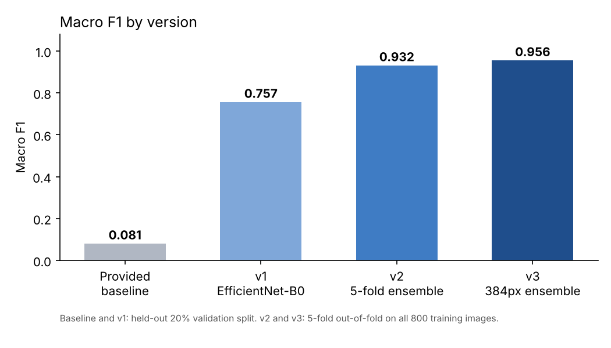

# Arabic Calligraphy Script Classification

Image classifier that identifies which of **12 Arabic calligraphy scripts** an image belongs to.
Built for the **Olo Academy Arabic Classification Challenge** (Kaggle), part of the AI Engineering Bootcamp (AIEP), Olo Academy in partnership with MCIT.

**Result: ranked 5th of 21 teams.** Macro F1 went from **0.08** (provided baseline) to **0.956** (5-fold out-of-fold).
Team of 2; I wrote all of the code.



## The problem

- **Data:** 800 labeled training images, 260 test images, 12 classes (64 to 68 images per class).
- **Metric:** macro F1, so every script counts equally.
- **Rules:** ImageNet-pretrained models allowed; no external calligraphy, OCR, or script datasets; Kaggle free-tier compute only.

## Approach

| Version | What changed | Macro F1 |
|---|---|---|
| Provided baseline | One conv layer, 64 px, 3 epochs | 0.081 (validation) |
| **v1** | ImageNet-pretrained **EfficientNet-B0**, 288 px, augmentation, stratified split, AdamW + cosine LR, label smoothing | 0.757 (validation), **0.77 public leaderboard** |
| **v2** | **5-fold stratified CV**, EfficientNet-B0 + **ConvNeXt-Tiny** (10 models), mixed precision, test-time augmentation, class-balanced predictions | 0.932 (out-of-fold) |
| **v3** | Added ConvNeXt-Tiny and **EfficientNetV2-S** at 384 px, 15 epochs; compared every model combination | **0.956** (out-of-fold) |

### Key decisions
- **Pretrained backbones instead of training from scratch:** with only ~67 images per class, a model trained from scratch cannot learn enough. Switching to ImageNet weights was the single biggest jump (0.08 to 0.76).
- **No horizontal flips:** Arabic script has a writing direction, so flipping would create unrealistic images. I used crops, small rotations, and color jitter instead.
- **ConvNeXt over EfficientNet alone:** in 5-fold CV, ConvNeXt-Tiny scored 0.924 vs 0.891 for EfficientNet-B0; ensembling both was better than either.
- **Class balancing for macro F1:** the predictions are re-weighted so each class gets a share close to its share in training, which stops the model from over-predicting a few classes.

## Results (5-fold out-of-fold, 800 images)

| Model | Macro F1 |
|---|---|
| EfficientNet-B0 | 0.891 |
| ConvNeXt-Tiny | 0.924 |
| EfficientNet-B0 + ConvNeXt-Tiny | 0.928 |
| + class balancing | 0.932 |
| ConvNeXt-Tiny 384 + EfficientNetV2-S 384 + class balancing | **0.956** |

**Note:** the best v3 combination was chosen using the same out-of-fold scores, so 0.956 is slightly optimistic. The official public leaderboard score of v1 was 0.77.

## How to run

1. Open the notebook in Kaggle and attach the competition data from the Input panel (GPU recommended).
2. Run the cells in order. Each version writes its own submission file.

```
pip install -r requirements.txt
```

## Files

- `arabic_calligraphy_classification.ipynb`: full pipeline (v1, v2, v3) with outputs
- `results.png`: macro F1 by version
- `requirements.txt`: Python packages

Competition data is not included. The data-loading setup is adapted from the organizers' starter notebook.

## Tech stack

Python, PyTorch, torchvision, scikit-learn, pandas, NumPy, Matplotlib, Kaggle Notebooks (GPU)

## Author

**Sarah Al-Bahesh** · [LinkedIn](https://www.linkedin.com/in/sarah-albahesh) · [GitHub](https://github.com/saravii7)
